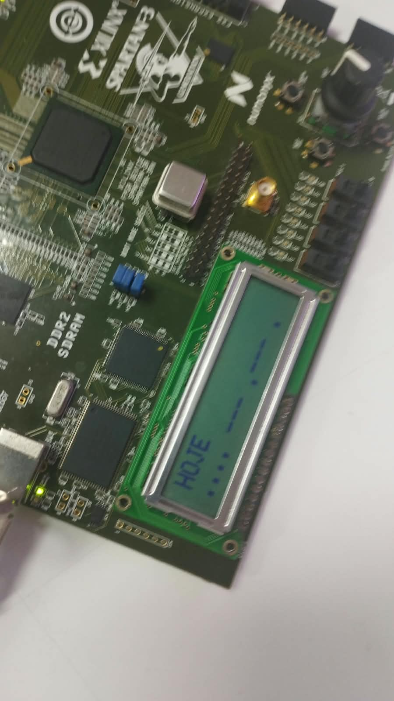

# PS/2 Keyboard → LCD with Morse Translation

VHDL project for the **Xilinx Spartan-3AN** board (50 MHz clock). It reads keys from a PS/2 keyboard, shows the typed characters on **line 1** of a 16x2 LCD (4-bit mode), and displays their Morse code translation on **line 2**.

The text is limited to **5 characters**.

## Demo



Running on the board: the typed text is shown on the first line and its Morse translation on the second.

## Files

| File | Description |
|---|---|
| `teclado_morse_lcd.vhd` | Main module (PS/2 receiver, translator, LCD controller) |
| `teclado_morse_lcd.ucf` | Pin constraints (clock, reset, PS/2, LCD) |
| `tb_teclado.vhd` | Testbench that emulates a PS/2 keyboard sending keys |
| `demo.jpg` | Photo of the project running on the board |

## How it works

The design is split into four blocks (processes):

1. **PS/2 receiver:** synchronizes `ps2_clk` to the system clock, detects its falling edge, and shifts the data bits into an 11-bit register (start + 8 data + parity + stop). When a frame is complete, it pulses `scan_ready` with the 8-bit scan code.
2. **Scan code → ASCII/Morse translator:** converts the scan code to ASCII and to its Morse pattern, and stores both in buffers. It handles the *break code* (`F0`, key release) by ignoring the scan code that follows it, and handles Backspace (`66`) by erasing the last character and its Morse symbols.
3. **LCD time base:** generates the `lcd_tick` pulse that paces the LCD state machine.
4. **LCD controller (FSM):** initializes the LCD in 4-bit mode and then continuously refreshes both lines from the buffers. Each byte is sent in 4 sub-steps (high nibble with E high, E low, low nibble with E high, E low).

### Morse format

Each letter takes `sym_len` positions in the buffer: the symbols (`.` and `-`) plus one blank position as a separator. For example, `A` (`.-`) uses 3 positions. The space key uses 3 blank positions.

The Morse buffer has 16 positions, and all of them are shown on line 2.

## Interface

| Port | Direction | Description |
|---|---|---|
| `clk` | in | 50 MHz clock |
| `rst` | in | Synchronous reset, active high |
| `ps2_clk` | in | PS/2 keyboard clock |
| `ps2_data` | in | PS/2 keyboard data |
| `lcd_rs` | out | Register select (0 = command, 1 = data) |
| `lcd_rw` | out | Fixed at `'0'` (write only) |
| `lcd_e` | out | LCD enable |
| `lcd_data[3:0]` | out | 4-bit data bus (D7..D4) |

### Pin assignments

Defined in `teclado_morse_lcd.ucf` (all LVCMOS33):

| Signal | Pin | Notes |
|---|---|---|
| `clk` | E12 | 50 MHz clock |
| `rst` | T13 | Reset button (BTN_NORTH), pull-down |
| `ps2_clk` | W12 | Pull-up |
| `ps2_data` | V11 | Pull-up |
| `lcd_rs` | Y14 | Drive 4 mA, slow slew |
| `lcd_rw` | W13 | Drive 4 mA, slow slew |
| `lcd_e` | AB15 | Drive 4 mA, slow slew |
| `lcd_data[0]` | Y13 | LCD DB4 |
| `lcd_data[1]` | AB18 | LCD DB5 |
| `lcd_data[2]` | AB17 | LCD DB6 |
| `lcd_data[3]` | Y15 | LCD DB7 |

## Supported keys

- Letters **A–Z** (PS/2 Scan Code Set 2)
- **Space**
- **Backspace** (deletes the last character)

Any other key is ignored.

## Building and running on the board

1. Create a project for the Spartan-3AN device in Xilinx ISE.
2. Add `teclado_morse_lcd.vhd` as the source and `teclado_morse_lcd.ucf` as the constraints file.
3. Set `teclado_morse_lcd` as the top-level module, then synthesize, implement and generate the programming file.
4. Program the board, connect a PS/2 keyboard and press the reset button.

Before running on hardware, check the timing note in *Things to be aware of* below.

## Simulation

The testbench `tb_teclado.vhd`:

1. Applies reset and waits 16 ms (LCD initialization);
2. Sends key **A** (`1C`);
3. Sends key **B** (`32`);
4. Sends the release of **B** (`F0`, `32`).

Each PS/2 frame uses an 80 µs bit period with odd parity. To simulate in ModelSim:

```
vcom teclado_morse_lcd.vhd
vcom tb_teclado.vhd
vsim work.tb_teclado
run 30 ms
```

Watch `lcd_rs`, `lcd_e` and `lcd_data` to follow the initialization commands and the characters sent to both lines.

## Things to be aware of

Observations about the current code that are worth knowing before testing on the board:

- **LCD timing:** with `clk_cnt = 5`, `lcd_tick` fires every 6 clock cycles (~120 ns). This works for simulation, but a real LCD usually needs much longer delays between commands (tens of µs to a few ms) and waits during initialization. For hardware, this value must be increased and/or delays added.
- **Morse buffer size:** the buffer has 16 positions, but 5 characters can take up to 25. Depending on the typed text, this may cause out-of-range accesses.
- **Space:** it counts as one of the 5 characters and takes 3 positions in the Morse line.
- **Extended keys:** codes with the `E0` prefix are not handled.
